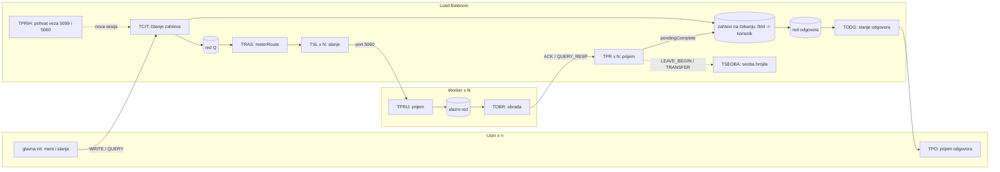

# Smart Meter Load Balancer

Servis za prikupljanje očitavanja pametnih brojila, raspoređen na **N Worker procesa** po pravilu `broj brojila % N`.
Kad se Worker odjavi, njegova brojila se sele na preostale; kad se vrati, vraćaju mu se, a upit za brojilo uvek vraća tačna i potpuna očitavanja.


> Industrijski komunikacioni protokoli (IKP), FTN Novi Sad, projektni zadatak 2 (2026/27): *Load Balancing – raspodela po broju brojila*.

## Sadržaj

- [Kako radi](#kako-radi)
- [Arhitektura](#arhitektura)
- [Protokol](#protokol)
- [Strukture podataka](#strukture-podataka)
- [Organizacija koda](#organizacija-koda)
- [Prevođenje](#prevođenje)
- [Pokretanje](#pokretanje)
- [Testovi](#testovi)
- [Status](#status)
- [Tim](#tim)

## Kako radi

Sistem ima tri vrste procesa:

| Proces | Uloga | Pokretanje |
| --- | --- | --- |
| **User (UR)** | šalje upise (brojilo, vreme, kWh) i upite za istoriju jednog brojila, ispisuje odgovore | `User.exe` |
| **Load Balancer (LB)** | prima zahteve na portu **5059**, Worker-e na portu **5060**, vodi mapu `brojilo → Worker` i prosleđuje zahteve | `LoadBalancer.exe <N>` |
| **Worker (WR)** | čuva sva očitavanja svojih brojila i odgovara na upise i upite | `Worker.exe <id>` (0 … N−1) |

Tok jednog upisa:

1. User pošalje `WRITE` sa svojim `requestId`.
2. LB mu dodeli jedinstveni `lbId`, zapamti ko je pitao i stavi zahtev u centralni red **Q**.
3. LB nađe vlasnika brojila (kućni WR = `brojilo % N`, ili trenutni vlasnik ako je brojilo preseljeno) i stavi zahtev u red tog Worker-a.
4. Worker upiše očitavanje i vrati `ACK`; LB po `lbId` nađe korisnika, vrati njegov originalni `requestId` i pošalje mu potvrdu.

Nijedna nit u LB-u ne čeka Worker-a: zahtevi i odgovori putuju kroz redove, pa više Worker-a može da radi istovremeno.

## Arhitektura



### Niti

| Proces | Nit | Koliko | Zadatak |
| --- | --- | --- | --- |
| LB | glavna | 1 | konzola (`s` = stanje, `q` = gašenje), pokreće i gasi sve niti |
| LB | TPRIH | 1 | `select` nad oba listen soketa; korisnik postaje nova sesija, Worker posle `REGISTER` ide u `workerAttach` |
| LB | TCIT | 1 | `select` nad svim korisnicima (`FD_SETSIZE` = 1024), novi `lbId`, upis u mapu na čekanju, red Q |
| LB | TRAS | 1 | skida zahteve sa Q i šalje ih preko `meterRoute` |
| LB | TSL | N | jedina nit koja šalje jednom Worker-u |
| LB | TPR | N | jedina nit koja prima od jednog Worker-a |
| LB | TSEOBA | 1 | seoba brojila pri odjavi i povratku Worker-a |
| LB | TODG | 1 | jedina nit koja šalje korisnicima |
| WR | glavna, TPRIJ, TOBR | 3 | konzola i odjava; prijem; obrada |
| UR | glavna, TPO | 2 | meni i slanje (prozor od 256 zahteva); prijem i ispis |

Broj niti u LB-u ne zavisi od broja korisnika, nego samo od N.

## Protokol

Svaka poruka ima zaglavlje od 12 bajtova, a iza njega telo dužine `length`. Svi brojevi idu u mrežnom redosledu bajtova; `float` i `int64` se okreću pomoćnim funkcijama iz NetLib-a (`floatToNet`, `i64ToNet`).

```c
typedef struct {
    uint16_t type;       // vrsta poruke
    uint16_t flags;      // FLAG_ALL uz RECLAIM
    uint32_t requestId;  // uparuje zahtev i odgovor
    uint32_t length;     // dužina tela u bajtovima
} MsgHeader;             // 12 bajtova

typedef struct {
    uint32_t meterId;    // broj brojila
    int64_t  timestamp;  // Unix sekunde
    float    kwh;        // potrošnja
} Reading;               // 16 bajtova
```

| Poruka | Smer | Telo |
| --- | --- | --- |
| `WRITE` | UR → LB → WR | jedan `Reading` |
| `QUERY` | UR → LB → WR | broj brojila |
| `ACK` | WR → LB → UR | status (0 = OK) |
| `QUERY_RESP` | WR → LB → UR | broj brojila, broj očitavanja, niz (vreme, kWh) |
| `ERROR` | LB → UR, LB → WR | kod greške |
| `REGISTER` / `REGISTER_OK` | WR ↔ LB | id Worker-a / prazno |
| `LEAVE_BEGIN` / `LEAVE_OK` | WR ↔ LB | prazno (najava odjave / dozvola za gašenje) |
| `RECLAIM` | LB → WR | lista brojila za predaju, ili `FLAG_ALL` = sva |
| `TRANSFER` | WR → LB → WR | najviše 512 očitavanja po paketu |
| `TRANSFER_END` | WR → LB, LB → WR | ukupan broj poslatih očitavanja (za proveru) |

Detalji su u [`NetLib/Common.h`](NetLib/Common.h).

## Strukture podataka

Sve strukture su napisane samostalno, bez STL-a, u statičkoj biblioteci `DSLib`, i svaka ima testove u `DSTests`.

| Struktura | Gde se koristi | Napomena |
| --- | --- | --- |
| **Hash mapa** (ulančavanje, ključ `uint32`) | LB: brojilo → vlasnik; LB: `lbId` → zahtev na čekanju; WR: brojilo → očitavanja; UR: `requestId` → zahtev | heš `key × 2654435761`, duplira se preko 75% popunjenosti, obilazak u delovima po 256 kanti |
| **Dinamički niz** | WR: očitavanja jednog brojila; LB: lista sesija u TCIT | elementi su jedan za drugim, pa se ceo niz šalje kao `QUERY_RESP` |
| **Proširivi kružni bafer** (kritična sekcija + semafor) | LB: red Q, red za slanje svakog WR-a, red odgovora; WR: ulazni red | producer/consumer, `rbPop` se prekida na `stopEvent` |
| **Ulančana FIFO lista** | LB: parking zahteva za brojila koja se sele | u izradi |

## Organizacija koda

```
SmartMeterLB.slnx
├── NetLib/          statička biblioteka: WinSock, recvAll/sendAll, slanje i prijem cele poruke, Common.h (protokol)
├── DSLib/           statička biblioteka: DynArray, HashMap, RingBuffer, FifoList
├── LoadBalancer/
│   ├── LoadBalancer.cpp   glavna nit, pokretanje i gašenje
│   ├── Dogovor.h          jedina mesta gde se dva dela LB-a pozivaju (potpisi + pravila)
│   ├── Users.*  Pending.* prednji deo: TPRIH, TCIT, TRAS, TODG, sesije, zahtevi na čekanju
│   └── Workers.* MeterMap.* deo prema Worker-ima: tabela radnika, TSL/TPR, mapa brojila
├── Worker/          Worker.exe i njegovo skladište (Storage)
├── User/            User.exe: meni, test1, stress, otisak; Client = veza i nit TPO
├── DSTests/         testovi struktura podataka
├── NetTests/        test NetLib-a: dva procesa razmene sve vrste poruka
├── pokreni.bat      pokreće ceo sistem
└── stress1.bat      stress test 1 za N = 1, 2, 5, 10
```

Dva dela LB-a se dodiruju samo kroz [`LoadBalancer/Dogovor.h`](LoadBalancer/Dogovor.h): `workerAttach`, `meterRoute`, `workerEnqueue` (deo prema Worker-ima) i `pendingComplete`, `pendingSetWorker`, `pendingFailWorker` (prednji deo). Tamo je i pravilo zaključavanja: mapa brojila se uvek zaključava pre mape zahteva na čekanju, nikad obrnuto.

## Prevođenje

1. Otvori `SmartMeterLB.slnx` u Visual Studio-u 2026 (projekti koriste alatni skup `v145`).
2. Izaberi platformu **x64** i konfiguraciju **Debug** (za rad) ili **Release** (za merenja).
3. **Build → Build Solution.** Izvršni fajlovi su u `x64\Debug` ili `x64\Release`.

## Pokretanje

### Najbrže

Dupli klik na `pokreni.bat` pokrene LB sa N = 10, deset Worker-a i jednog User-a koji odradi funkcionalni test 1. Iz komandne linije:

```bat
pokreni.bat                    :: N = 10, funkcionalni test 1
pokreni.bat 5                  :: N = 5
pokreni.bat 10 meni            :: User otvara meni
pokreni.bat 10 stress 0 10000  :: 10.000 upisa
```

### Ručno

Svaki proces u svom prozoru, ovim redom:

```bat
x64\Debug\LoadBalancer.exe 10
x64\Debug\Worker.exe 0
x64\Debug\Worker.exe 1
...
x64\Debug\User.exe
```

### User

| Komanda | Šta radi |
| --- | --- |
| `User.exe` | meni: `1` upis, `2` upit, `0` izlaz |
| `User.exe test1` | funkcionalni test 1: 10 upisa za brojila 3, 13 i 27, pa upit za svako i provera |
| `User.exe stress <prvo> <broj> [poBrojilu]` | upisi za brojila `prvo … prvo+broj−1`; meri upise u sekundi i kašnjenje (prosek, najgorih 1%) |
| `User.exe otisak <prvo> <broj> [fajl]` | za svako brojilo broj očitavanja i zbir u Wh + kontrolni zbir; dva otiska se porede pre i posle seobe |

### Konzola

| Proces | Taster | Šta radi |
| --- | --- | --- |
| LoadBalancer | `s` | stanje: korisnici, zahtevi, odgovori, bajtovi |
| LoadBalancer | `q` ili Ctrl+C | uredno gašenje; Worker-i se gase za njim |
| Worker | `q` | odjava (`LEAVE_BEGIN`): podaci se predaju drugim Worker-ima |
| Worker | `s` | broj brojila i očitavanja |
| Worker | Ctrl+C | gašenje bez odjave (podaci se gube, LB to vidi kao pad) |

## Testovi

| Test | Kako se pokreće | Šta proverava |
| --- | --- | --- |
| Strukture podataka | `DSTests.exe` | dinamički niz, hash mapa, kružni bafer (rast, brisanje, proširenje, 4 proizvođača i 4 potrošača) |
| NetLib | `NetTests.exe` | dva procesa razmene svih 12 vrsta poruka (15 slučajeva, uključujući odgovor od 1,2 MB), tamo i nazad; redosled bajtova; odbijanje pogrešne dužine |
| Funkcionalni test 1 | `pokreni.bat` (ili `User.exe test1`) | upisi i upiti za nekoliko brojila |
| Stress test 1 | `stress1.bat` (Release) | propusnost upisa za N = 1, 2, 5, 10 uz brojače Performance Monitor-a; rezultati idu u `rezultati\` |

Stress test 1, Release x64, jedan računar sa 8 logičkih jezgara, 4 korisnika istovremeno, 10.000 upisa:

| N | Upisa / s | Prosečno kašnjenje (ms) | Najgorih 1% (ms) | Niti u LB |
| --- | --- | --- | --- | --- |
| 1 | 26.596 | 31,4 | 74,2 | 10 |
| 2 | 19.724 | 44,2 | 94,8 | 12 |
| 5 | 21.692 | 39,8 | 83,4 | 18 |
| 10 | 18.519 | 47,5 | 106,4 | 28 |

Propusnost ne raste sa N, jer je usko grlo sam LB (oko 2,3 jezgra), dok svi Worker-i zajedno troše oko jednog jezgra. Objašnjenje i brojači su u dokumentaciji projekta.

## Status

- [x] Protokol, NetLib i test NetLib-a
- [x] Dinamički niz, hash mapa, kružni bafer, sa testovima
- [x] User: meni, prozor od 256 zahteva, test1, stress, otisak
- [x] LB: prijem korisnika, raspodela, zahtevi na čekanju, slanje odgovora
- [x] LB: tabela radnika, TSL/TPR, mapa brojila, pad Worker-a bez odjave
- [x] Worker: upis, upit, predaja podataka, uredno gašenje
- [x] Funkcionalni test 1, stress test 1
- [ ] FIFO lista, parking i seoba brojila (odjava i povratak Worker-a)
- [ ] Funkcionalni testovi 2–5, stress test 2
- [ ] UMDH izveštaj i provera handle-ova
- [ ] Dokumentacija i predaja

## Tim

| | Zaduženje |
| --- | --- |
| **Marija** (Osoba 1) | User, prednji deo LB-a, dinamički niz, hash mapa, stress test 1 |
| **Gordana** (Osoba 2) | Worker, deo LB-a prema Worker-ima i seoba, kružni bafer, FIFO lista, stress test 2 |
| Zajedno | protokol, NetLib, testovi gašenja i curenja memorije, dokumentacija |
